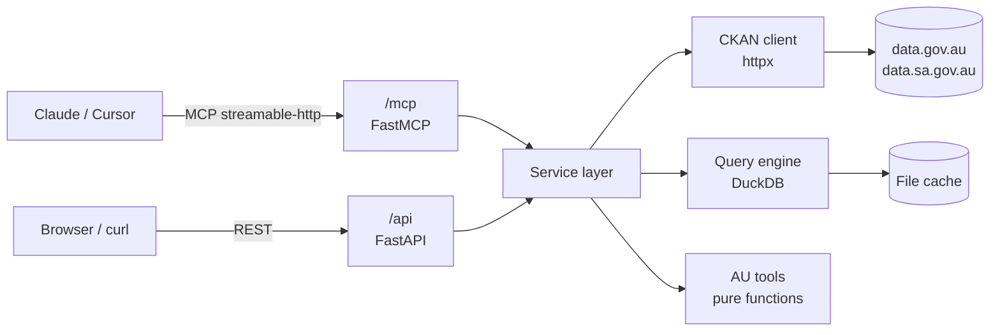

# PRD — AU Open Data MCP

## 1. Summary

Build a self-hostable MCP server that wraps Australian government open data (data.gov.au and data.sa.gov.au) as tools an AI can call directly. It mirrors Taiwan's Twinkle Hub, but v1 covers only the core mechanism: no accounts, billing or SaaS. The stack is Python 3.12 + FastAPI + FastMCP, with one service exposing both MCP (`/mcp`) and REST (`/api`). Working name: `au-opendata-mcp`.

## 2. Background and problem

- data.gov.au aggregates fede>ral, state and territory datasets, over 70,000 by third-party counts, but it is only reachable via the website or the CKAN API.
- AI assistants cannot go straight from "find data → read data → compute". Users must download CSVs, clean them and paste them back.
- The CKAN API returns metadata only. The actual data sits in mixed formats behind external links, with uneven quality.
- Twinkle Hub proves the model works in Taiwan. Australia has no equivalent open-source implementation.

## 3. Goals and non-goals

**Goals**

1. After one setup, AI clients (Claude Desktop, Claude Code, Cursor) can search, read and query Australian open data.
2. Safe tabular queries: SELECT only, with row and file-size limits.
3. Deterministic Australian utility tools (ABN/ACN validation, financial-year conversion and more).
4. Every result carries its source link and licence, meeting CC BY attribution.
5. Clean structure and solid tests.

**Non-goals (not in v1)**

- User accounts, API key issuance, billing or quotas.
- A web frontend or dashboard.
- A full data mirror or daily full crawl.
- The ABS SDMX statistics API and other state portals (future phase).

## 4. Users and scenarios

**Primary users**: developers, data analysts, researchers and students asking about Australian public data inside an AI client.

**User stories**

- As an analyst, I ask "what bus stop data does SA have?" and the AI finds the dataset and lists its files.
- As a researcher, I ask "what's the average per region in this CSV?" and the AI queries it and answers with the source.
- As a developer, I paste an ABN and the AI validates it with a deterministic algorithm instead of guessing.
- As a developer, I call `curl /api/datasets?q=...` and get the same results for integration elsewhere.

## 5. Scope and phases

| Phase | Contents | In v1 |
| --- | --- | --- |
| Phase 1 | CKAN client, `search_datasets`, `get_dataset`, `list_organizations`, `list_portals`, stdio and streamable-http | Yes |
| Phase 2 | `query_rows` query layer: DataStore first, else download and query with DuckDB, plus caching | Yes |
| Phase 3 | Australian tools: ABN, ACN, financial year, postcode to state, BSB format | Yes |
| Phase 4 | ABS SDMX, other state portals (NSW, VIC, QLD), Docker and Cloud Run deployment | No (future) |

## 6. Functional requirements: MCP tools

Each tool has a matching REST endpoint, and both share one service layer.

| Tool | Purpose | Main inputs | Output | Phase |
| --- | --- | --- | --- | --- |
| `list_portals` | List supported portals | none | portal name, base URL | 1 |
| `search_datasets` | Keyword search for datasets | `q`, `portal`, `organization`, `format`, `limit` (≤ 50) | id, title, organisation, formats, modified date | 1 |
| `get_dataset` | Dataset details | `dataset_id`, `portal` | metadata, licence, resources (format, URL, in DataStore or not) | 1 |
| `list_organizations` | List publishers | `portal`, `q` | organisation names and dataset counts | 1 |
| `query_rows` | Query a tabular resource | `resource_id`, `sql` (optional), `limit` (≤ 100) | columns, rows, source URL, licence | 2 |
| `validate_abn` | Check ABN checksum | 11 digits | valid or not, normalised format | 3 |
| `validate_acn` | Check ACN checksum | 9 digits | valid or not | 3 |
| `au_financial_year` | Map a date to the Australian FY | date | e.g. FY2026–27, start and end dates | 3 |
| `postcode_to_state` | Map a postcode to a state or territory | 4 digits | state code | 3 |
| `validate_bsb` | Check BSB format | string | matches `NNN-NNN` or not | 3 |

**`query_rows` strategy**

1. Resource is in the CKAN DataStore → use `datastore_search` (no SQL) or `datastore_search_sql`.
2. Otherwise, if it is CSV or XLSX under 50 MB → download, load into DuckDB, run the SQL.
3. Any other format → return a clear error plus the original download link.

SQL refers to the resource by the fixed table name `t`, e.g. `SELECT suburb, AVG(price) FROM t GROUP BY suburb`.

## 7. Architecture

MCP and REST are just two interfaces; all logic lives in the service layer so it is easy to test and reuse.

**Modules**

- `app/main.py`: FastAPI app; mounts FastMCP at `/mcp`, plus `/api` and `/health`.
- `app/mcp_server.py`: registers tools with FastMCP; each tool only calls a service.
- `app/services/catalog.py`: multi-portal CKAN client with retries and timeouts.
- `app/services/query.py`: DataStore queries and DuckDB queries.
- `app/services/au_tools.py`: pure-function tools.
- `app/config.py`: portal list, size limits, cache TTLs, set by environment variables.
- `tests/`: pytest, using recorded API responses as fixtures.

## 8. Non-functional requirements

| Area | Requirement |
| --- | --- |
| Performance | Cached queries < 200 ms; search depends on upstream, 15 s timeout |
| Caching | Metadata TTL 1 hour; downloaded files TTL 24 hours, 1 GB disk cap |
| Download limits | ≤ 50 MB per file, 30 s timeout, http/https only |
| SSRF protection | Only download resource URLs listed in the catalog; reject private IPs and localhost |
| SQL safety | Single SELECT statement; DuckDB external access disabled after load; ≤ 100 rows returned |
| Attribution | Every result includes dataset URL, organisation and licence |
| Observability | Structured logs: tool name, duration, upstream status code |
| Quality | ≥ 80% test coverage on the service layer; GitHub Actions runs lint and tests |

## 9. Data sources

- **data.gov.au** runs CKAN; the Action API lives at `https://data.gov.au/data/api/action/` and supports `datastore_search` and `datastore_search_sql` ([API snippet page](https://data.gov.au/data/api/1/util/snippet/api_info.html?resource_id=c4972df1-faeb-4d0f-8e79-d43d4c7bd30a)).
- data.gov.au maintains its own CKAN extension, last updated March 2026 ([GitHub: datagovau](https://github.com/datagovau)).
- The catalog covers ABS, AEMO, BoM and every state and territory, about 70,000+ datasets by a third-party count ([Apify listing](https://apify.com/parseforge/australia-data-gov-au-scraper)).
- **data.sa.gov.au**: expected to be CKAN as well; verify before development.

## 10. Success metrics

- ≥ 95% tool-call success across 20 sample questions.
- 3 demo scenarios reproducible end to end in Claude Desktop (search, aggregate query, ABN validation).
- A new user finishes local setup from the README in under 5 minutes.
- ≥ 80% test coverage on the service layer.

## 11. Risks and mitigations

| Risk | Impact | Mitigation |
| --- | --- | --- |
| Messy CSVs (encoding, headers, merged cells) | Query fails | DuckDB `read_csv_auto` with lenient options; return the raw link on failure |
| Broken resource links | Nothing to query | HEAD check before download; clear error message |
| `datastore_search_sql` may need an API token | Reduced features | Token optional; fall back to DuckDB without it |
| Unknown upstream rate limits | Intermittent failures | Caching, exponential backoff, concurrency cap |
| Large files | Memory and latency | 50 MB cap; above it, return metadata only |
| Licence differences | Compliance | Always return the licence field; README states user responsibility |

## 12. Milestones

| Week | Deliverable |
| --- | --- |
| Week 1 | Phase 1: project skeleton, CKAN client, 4 catalog tools, stdio and HTTP working with Claude Desktop |
| Week 2 | Phase 2: `query_rows`, caching, safety limits, fixture tests |
| Week 3 | Phase 3: Australian tools, README, demo scenarios, CI |

## 13. Open questions

- [ ] Is v1 scope confirmed as Phases 1–3?
- [ ] Include data.sa.gov.au, and confirm its CKAN endpoint?
- [ ] Local only, or deploy to Cloud Run in v1?
- [ ] Final project name?
- [ ] Does `datastore_search_sql` require an API token?

## Sources

- [data.gov.au CKAN Data API snippet](https://data.gov.au/data/api/1/util/snippet/api_info.html?resource_id=c4972df1-faeb-4d0f-8e79-d43d4c7bd30a)
- [data.gov.au on GitHub](https://github.com/datagovau)
- [Australia Open Data (data.gov.au) Scraper, Apify](https://apify.com/parseforge/australia-data-gov-au-scraper)
